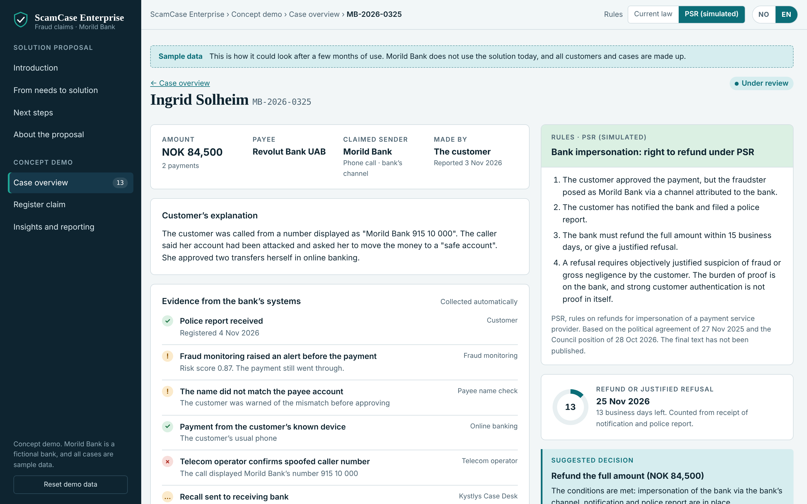

# ScamCase Enterprise – svindelkrav i Morild Bank

En klikkbar konseptdemo av et løsningsforslag: saksbehandling av krav fra bankkunder som er svindlet av noen som utga seg for å være banken. Demoen viser hvordan en bank kan samle kravene i én saksflyt, finne riktig regelverk for hvert krav, holde fristene og dokumentere beslutningene, både etter dagens norske regler og etter EUs nye betalingsforordning (PSR). Morild Bank, leverandøren Kystlys Software og ScamCase Enterprise er fiktive, og alle saker er syntetiske.

**Live-demo:** [scamcase-enterprise.pages.dev](https://scamcase-enterprise.pages.dev) (norsk og engelsk, åpner på engelsk)

## Bakgrunn

- Svindlet beløp i Norge var 962 millioner kroner i 2025, og over halvparten av beløpet i andre halvår var sosial manipulasjon (Finanstilsynet).
- Finansklagenemnda fikk 834 klager om svindel i 2025.
- PSR gir kunden rett til refusjon når svindleren utgir seg for å være kundens egen bank via bankens kanaler, og banken har 15 virkedager på å refundere eller gi et begrunnet avslag. Politisk enighet i EU 27.11.2025, Rådets posisjon 28.10.2026. Reglene gjelder 21 måneder etter ikrafttredelse, og i Norge først etter innlemmelse i EØS-avtalen.

## Hva demoen viser

| Del | Innhold |
|---|---|
| Løsningsforslag | Sju behov fra en (fiktiv) workshop, tabell fra behov til løsning og gevinst, et justerbart business case, pilotplan, datakrav, integrasjoner og fremdrift. |
| Saksoversikt | Kø med alle åpne krav, sortert etter frist, med regelverk og status. |
| Sak | Bevis fra bankens systemer, regelverksvurdering, fristklokke i norske virkedager, forslag til beslutning med begrunnelse, brevutkast og hendelseslogg. |
| Registrer krav | Skjema der regelverk, frist og forslag oppdateres mens du svarer. |
| Innsikt | Krav per måned og svindeltype, hva PSR vil bety for banken, utkast til halvårsrapportering og signaler til teleoperatører. |

Bryteren **Gjeldende rett / PSR (simulert)** viser hvordan samme sak behandles i dag og etter PSR.

## Regelverksvurderingen

Tre spørsmål avgjør hvilket regelverk som gjelder: hvem som utførte betalingen, hvem svindleren utga seg for å være, og om kontakten kom via en kanal som hører til banken.

| Regelverk | Når | Frist |
|---|---|---|
| Uautorisert betaling | Svindleren betalte med kundens innloggingsdata (finansavtaleloven §§ 4-30 og 4-32) | Neste virkedag |
| Bank-imitasjon i dag | Kunden betalte selv etter å ha blitt lurt av «banken». Ingen lovfestet refusjonsrett. | Intern målfrist |
| Bank-imitasjon etter PSR | Samme situasjon etter PSR: rett til refusjon | 15 virkedager |
| Annen svindel | For eksempel falsk politi eller investeringssvindel | Intern målfrist |

Grunnlaget er finansavtaleloven, Høyesteretts dommer HR-2022-1752-A og HR-2024-990-A, Finansklagenemndas praksis og PSR-teksten fra den politiske enigheten. Forslagene er beslutningsstøtte. Saksbehandleren tar beslutningen.

## Slik er den laget

1. Undersøkelse av regelverk, statistikk og marked med Claude (Finanstilsynet, Finansklagenemnda, domstolene, EØS-notat og EU-kilder).
2. Beslutningsgrunnlag: om saksbehandling av svindelkrav er et reelt og riktig avgrenset behov.
3. Løsningsforslag og konseptdemo, bygget og testet med Claude.
4. Automatisk test i nettleser (Playwright) på norsk og engelsk, PC og mobil, lyst og mørkt tema, og kontroll av fristberegning rundt jul og påske.

## Teknisk

- Én fil, `index.html`, med HTML, CSS og JavaScript uten rammeverk. Ingen server og ingen innsamling av data.
- Endringer du gjør i demoen lagres bare i din egen nettleser. Knappen «Tilbakestill demodata» setter alt tilbake.
- Kjør lokalt ved å åpne `index.html` i en nettleser.

## Forbehold

Uavhengig konseptdemo laget av Stein Wulvik. Morild Bank, Kystlys Software og ScamCase Enterprise er fiktive. Demoen er ikke juridisk rådgivning.
